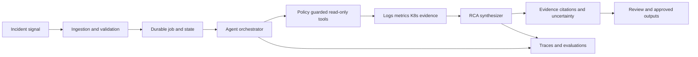

# Flagship: AI Incident Intelligence Platform

An architect-grade **reference system**, building from prior agentic SRE experience with synthetic or otherwise authorized incidents.

## Scope and success definition

From an incident signal, produce a **traceable, evidence-backed root cause analysis** with safe, read-only diagnosis. Subsequently add quality evaluations, failure recovery, model/context optimization, and ultimately **approval-gated** remediation as a separate optional phase.

## Reference flow

## Staged plan

1. **Read-only MVP:** synthetic incidents, retrieval/runbooks, deterministic tool contracts, evidence-linked RCA; no production credentials.
2. **Measurement:** end-to-end traces, labeled eval set, task success, latency, tokens, spend, false RCA classification.
3. **Reliability:** durable state, timeouts, retries, idempotency, circuit breakers, partial/tool failure and pod restarts.
4. **Optimization:** compare context strategies, model routing, inference/serving options, load and cost.
5. **Controlled remediation (later):** narrow scoped permissions, human approval, audit and rollback or safety constraints.

## Architect evidence pack

- Context and container-level architecture diagrams.
- API, tool and state-machine contracts.
- At least three ADRs (e.g., durable queue, storage, model selection).
- Evaluation dataset provenance and rubric.
- Reproducible benchmark (inputs, workload, environment, sample size, p50/p95, error rate, cost).
- Failure-mode and threat-model analysis.
- SLO proposal with error-budget rationale.
- Sanitized case study and review feedback.

## Initial measurable metrics (targets intentionally unset)

| Metric | Definition |
|---|---|
| Task success | Valid evidence-backed diagnosis / evaluation incidents |
| Unsupported claims | RCA claims not backed by tool evidence / claims examined |
| Latency | p50 and p95 from intake to final RCA |
| Reliability | Failed, retried, duplicate and recovered jobs |
| Agent cost | Tokens, model spend and compute cost per successful RCA |
| Tool safety | Unauthorized calls blocked; approvals required for state-changing actions |

Define thresholds **after** a representative baseline, not by guessing.

## Not in the first month

Autonomous remediation, real production connectivity, multi-tenant billing, a full frontend, or training a new foundational model. Keep the core small and verifiable.
